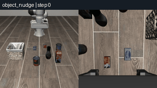
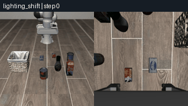

# Break-My-VLA

<p align="center">
  <strong>Interactive Physical, Visual &amp; Systems Chaos Playground + Closed-Loop Quantization Benchmark for Vision-Language-Action (VLA) Models</strong>
</p>

<p align="center">
  <a href="https://jasperxzy.github.io/Break-My-VLA/"></a>
  <a href="https://colab.research.google.com/github/JasperXzy/Break-My-VLA/blob/main/notebooks/break_my_vla_m2_colab.ipynb"></a>
  <a href="https://github.com/JasperXzy/Break-My-VLA/actions/workflows/ci.yml"></a>
  
  
</p>

**Break-My-VLA** turns offline VLA robustness and edge-quantization benchmarks into a real-time interactive chaos arena. Inject live physical nudges, lighting shifts, camera jitters, control-loop latency, and runtime precision/denoise downgrades (`BF16` → `FP8` / `INT8` / `NVFP4`, `10 → 2` denoise steps) while watching open-source VLAs fight to finish closed-loop manipulation tasks.

> **Try it in your browser (zero GPU required):** open the **[Live Arcade &amp; Replay Gallery](https://jasperxzy.github.io/Break-My-VLA/)** to inspect real NVIDIA L4 LIBERO rollouts, compare 5-axis stress radar charts, or play the Local Demo Arcade.

---

## Real LIBERO + SmolVLA Results (M2 Smoke · NVIDIA L4)

Measured closed-loop on `libero_object` Task 0 (*"pick the alphabet soup and place it in the basket"*, max 280 steps, replan every 10 actions, EGL renderer, [`lerobot/smolvla_libero`](https://huggingface.co/lerobot/smolvla_libero)):

| Scenario | Precision &amp; Steps | Chaos Injection (Step 20) | Outcome | Steps | Latency (P50 / Mean) | Wall Time |
| :--- | :---: | :--- | :---: | :---: | :---: | :---: |
| **Baseline** | `BF16` · 10 steps | None | **PASS** | **139** | 343.9 / 381.4 ms | 31.2 s |
| **Object Nudge** | `BF16` · 10 steps | Translate `alphabet_soup_1` by `(+12 cm, -8 cm)` | **FAIL** | 280 *(timeout)* | 340.6 / 341.8 ms | 57.3 s |
| **Lighting Shift** | `BF16` · 10 steps | Diffuse brightness `0.18` (main luma `105 → 61`, **-42%**) | **PASS** | **128** | 341.2 / 343.2 ms | 28.4 s |
| **INT8 + 2 Steps** | **`INT8` · 2 steps** | Per-channel INT8 across 125 linear layers + 2 denoise steps | **PASS** | **139** | **120.0 / 120.4 ms (2.86× faster)** | **27.5 s** |

### Visual Comparison (Dual-Camera LIBERO Rollouts)

| Baseline (`BF16` · 10-step · PASS in 139 steps) | Object Nudge (`+12cm, -8cm` · FAIL at 280 steps) |
| :---: | :---: |
|  |  |

| Lighting Shift (`-42%` luma · PASS in 128 steps) | INT8 + 2-Step (`120 ms` · 2.86× faster · PASS in 139 steps) |
| :---: | :---: |
|  |  |

Full verified run metadata (checkpoint SHA, GPU, renderer, before/after object coordinates &amp; luminance): [`benchmarks/results/m2_smoke/metrics.json`](benchmarks/results/m2_smoke/metrics.json).

---

## Architecture

To avoid Python/CUDA dependency conflicts across VLA frameworks (`lerobot`, `openpi`, `GR00T`, `openvla-oft`, `TensorRT`), the simulator and policy runtimes are strictly decoupled over HTTP/WebSocket:

```text
[React + Vite Arcade UI & Replay Gallery (frontend/)]
        │  WebSocket /ws/session (dual cameras, telemetry, chaos triggers)
        ▼
[Chaos Sim Server (backend/chaos_sim/)]
  ├── CPU Pick Env (zero-GPU quickstart & CI)
  └── LiberoEnvAdapter (MuJoCo qpos/xfrc/friction/light/camera hooks)
        │  HTTP POST /act  &  GET /health
        ▼
[Isolated Policy Servers (backend/policy_servers/)]
  ├── mock_server.py       (CPU deterministic mock, BF16/FP8/INT8/NVFP4 jitter)
  ├── smolvla_server.py    (lerobot/smolvla_libero · BF16 & 125-layer INT8)
  └── (Roadmap M3/M4)      (Pi0.5 / Isaac GR00T · TensorRT FP8 & Blackwell NVFP4)
```

### 4 Chaos Skill Categories (8 Live Interventions)
1. **Physical Chaos**: `object_nudge` (`qpos`), `arm_kick` (`xfrc_applied`), `friction_glitch` (`geom_friction`)
2. **Visual Chaos**: `lighting_shift` (`light_diffuse`), `camera_shake` (`cam_pos/quat`), `occlusion_patch`
3. **Systems Chaos**: `latency_inject` (`0–300 ms`), `wrist_blackout` (2s wrist camera drop)
4. **Brain Downgrade**: live `BF16` / `FP8` / `INT8` / `NVFP4` switching &amp; Flow-Matching denoise steps (`1–10`)

---

## Quick Start (CPU Zero-GPU Mode)

Run the full interactive Arcade UI + Chaos Sim + Mock Policy Server on any laptop in 60 seconds:

```bash
# Terminal 1 — Mock Policy Server (:8001)
uv run python -m backend.policy_servers.mock_server

# Terminal 2 — Chaos Sim WebSocket Server (:8000)
uv run python -m backend.chaos_sim.server

# Terminal 3 — Frontend Arcade UI (:5173)
cd frontend && npm ci && npm run dev
```

Open `http://localhost:5173`, press hotkeys `1`–`8` to inject chaos, switch precision/denoise sliders, or click **Export GIF** to capture a replay.

### Real LIBERO + SmolVLA on GPU (Colab or Local CUDA)

- **One-click Colab**: open [`notebooks/break_my_vla_m2_colab.ipynb`](notebooks/break_my_vla_m2_colab.ipynb) on an L4 / G4 / A100 runtime.
- **CLI Launcher** (with `google-colab-cli`):
  ```bash
  python3 scripts/colab_m2_smolvla.py launch --gpu L4
  ```
- **Live LIBERO + SmolVLA Server** (on a GPU host with `lerobot[smolvla,libero]` installed):
  ```bash
  python -m backend.policy_servers.smolvla_server
  CHAOS_SIM_ENV=libero LIBERO_SUITE=libero_object python -m backend.chaos_sim.server
  ```

---

## Development &amp; Verification

```bash
# Backend checks (ruff + 83 pytest tests)
uv run ruff check .
uv run pytest -q

# Frontend checks (eslint + vitest + tsc/vite build)
cd frontend && npm run check
```

See [`SPEC.md`](SPEC.md), [`backend/shared/PROTOCOL.md`](backend/shared/PROTOCOL.md), and [`docs/FRONTEND_GUIDE.md`](docs/FRONTEND_GUIDE.md) for wire protocol schemas and gallery dataset formats.

## Roadmap

- [x] **M1**: Decoupled FastAPI Chaos Sim, 8 chaos skills, Mock Policy Server, Cyber-Arcade Web UI &amp; GIF export
- [x] **M2**: Real `LiberoEnvAdapter` (MuJoCo), `SmolVLA` BF16/INT8 server, verified L4 rollouts, Benchmark &amp; Replay Gallery + GitHub Pages
- [ ] **M3**: Multi-VLA arena (`pi05_libero`, `Isaac GR00T`, `OpenVLA-OFT`)
- [ ] **M4**: TensorRT `BF16` / `FP8` / Blackwell `NVFP4` Auto-Chaos Level 0–5 full leaderboard
